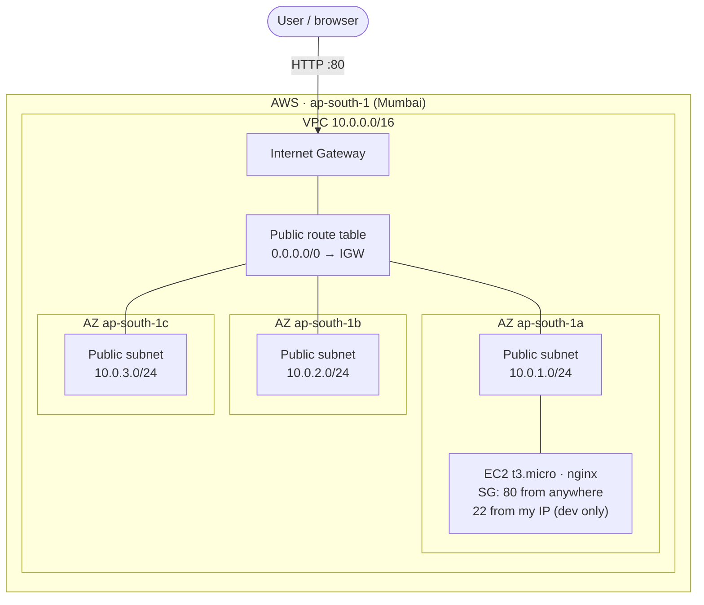
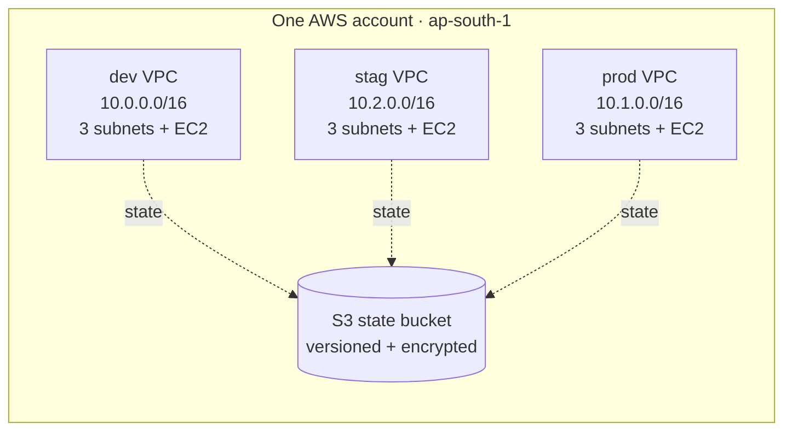
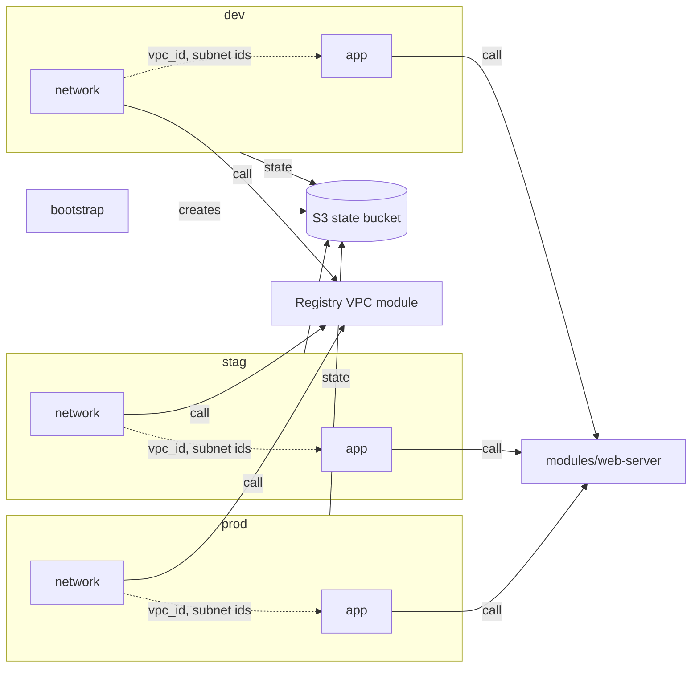

<div align="center">

# terraform-aws-mastery

Learning Terraform on AWS by building real infrastructure, step by step.


</div>

---

I started this repo to learn Terraform properly, not just copy snippets. I build `dev` for real, check it in the browser, then destroy it at the end of each session. `stag` and `prod` run the same code with different settings. The layout follows what I see at work: environment first, then component, with shared modules on the side.

## Contents

- [What gets built](#what-gets-built)
- [Repo layout](#repo-layout)
- [System design](#system-design)
- [Setup](#setup)
- [Quick start](#quick-start)
- [Command cheat sheet](#command-cheat-sheet)
- [Notes and decisions](#notes-and-decisions)
- [Terraform features used](#terraform-features-used)

## What gets built

For each environment (`dev`, `stag`, `prod`):

| Component | What's inside | Comes from |
|---|---|---|
| `network` | VPC, 3 public subnets (one per AZ), internet gateway, route table | [terraform-aws-modules/vpc](https://registry.terraform.io/modules/terraform-aws-modules/vpc/aws) |
| `app` | Security group + EC2 running nginx | [`modules/web-server`](modules/web-server) (inputs and outputs in its README) |

Plus one S3 bucket, made by `bootstrap/`, that stores the state of everything else.

| | dev | stag | prod |
|---|---|---|---|
| VPC CIDR | `10.0.0.0/16` | `10.2.0.0/16` | `10.1.0.0/16` |
| Subnets | `10.0.1-3.0/24` | `10.2.1-3.0/24` | `10.1.1-3.0/24` |
| SSH | open to my IP only | off | off |
| Instance | `t3.micro` | `t3.micro` | `t3.micro` |

`stag` is a copy of `prod` with its own IP range. Changes go dev → stag → prod.

## Repo layout

```
.
├── modules/
│   └── web-server/          # reusable: security group + EC2 + nginx
├── bootstrap/               # S3 bucket for remote state (keeps its own state locally)
├── global/                  # account-wide things like IAM (not tied to one env)
├── dev/
│   ├── network/             # state key: dev/network/terraform.tfstate
│   └── app/                 # state key: dev/app/terraform.tfstate
├── stag/
│   ├── network/
│   └── app/
├── prod/
│   ├── network/
│   └── app/
├── backend.hcl.example      # copy to backend.hcl
├── docs/learning-log.md     # what I covered and what comes next
└── CLAUDE.md                # instructions for Claude Code
```

Each folder is its own Terraform root with its own state. Breaking `app` can't touch `network`, and a plan in one folder only looks at that folder's resources.

**Every folder has its own README** with step-by-step instructions. This page is the summary.

| Folder | README |
|---|---|
| `bootstrap` | [create the state bucket](bootstrap) |
| `modules/web-server` | [inputs, outputs, usage](modules/web-server) |
| `dev`, `stag`, `prod` | [dev](dev) · [stag](stag) · [prod](prod): settings and apply order |
| `<env>/network` | [dev](dev/network) · [stag](stag/network) · [prod](prod/network) |
| `<env>/app` | [dev](dev/app) · [stag](stag/app) · [prod](prod/app) |

## System design

### Inside one environment

This is `dev`. `stag` and `prod` look the same with their own IP ranges.



The server runs in the first subnet. The other two are ready for when the app grows to more servers behind a load balancer.

### All environments



The three VPCs are fully separate. No peering, no shared subnets. The IP ranges don't overlap, so they can still be connected later without renumbering anything.

### How Terraform ties it together



- Every environment has the same two folders, `network` and `app`. Only their inputs differ (IP range, SSH on or off).
- All six folders keep their state in one bucket, each under its own key: `dev/network/terraform.tfstate`, `stag/app/terraform.tfstate` and so on.
- Inside each environment, `app` reads the `network` outputs through `terraform_remote_state`. It never hardcodes a VPC ID, so `network` has to be applied first.
- All three networks call the same Registry module, and all three apps call the same `web-server` module. A fix in a module reaches every environment.

### Design choices

| Area | What I did | Why |
|---|---|---|
| Isolation | One VPC per environment, separate state per component | a mistake in dev can't reach prod |
| Availability | Subnets in all 3 AZs | room to spread servers out later |
| Security | SSH closed in stag and prod, IMDSv2 required, state bucket private and encrypted | smallest possible attack surface |
| Cost | No NAT gateway, no load balancer, `t3.micro` | keeps the bill close to zero while learning |

<details>
<summary><b>Known limits (on purpose, for now)</b></summary>

<br>

- One server means one point of failure. The next step would be an Auto Scaling group behind an ALB across all three subnets.
- Only public subnets. A real app would put servers in private subnets and only expose the load balancer.
- Plain HTTP. HTTPS needs a domain and an ACM certificate on a load balancer.
- All environments share one AWS account. Companies usually give each environment its own account.

</details>

## Setup

One-time setup on your machine and in your AWS account. Tested with Terraform 1.17 and AWS CLI 2.34.

### 1. Install Terraform

<details>
<summary><b>Windows</b></summary>

<br>

```powershell
winget install Hashicorp.Terraform
```

</details>

<details>
<summary><b>macOS</b></summary>

<br>

```bash
brew tap hashicorp/tap
brew install hashicorp/tap/terraform
```

</details>

<details>
<summary><b>Linux (Ubuntu / Debian)</b></summary>

<br>

```bash
wget -O- https://apt.releases.hashicorp.com/gpg | sudo gpg --dearmor -o /usr/share/keyrings/hashicorp-archive-keyring.gpg
echo "deb [signed-by=/usr/share/keyrings/hashicorp-archive-keyring.gpg] https://apt.releases.hashicorp.com $(lsb_release -cs) main" | sudo tee /etc/apt/sources.list.d/hashicorp.list
sudo apt update && sudo apt install terraform
```

</details>

Check it:

```bash
terraform version
```

You need 1.11 or newer. The state backend uses native S3 locking (`use_lockfile`), which became stable in 1.11.

### 2. Install the AWS CLI

<details>
<summary><b>Windows</b></summary>

<br>

```powershell
winget install Amazon.AWSCLI
```

</details>

<details>
<summary><b>macOS</b></summary>

<br>

```bash
brew install awscli
```

</details>

<details>
<summary><b>Linux</b></summary>

<br>

```bash
curl "https://awscli.amazonaws.com/awscli-exe-linux-x86_64.zip" -o awscliv2.zip
unzip awscliv2.zip
sudo ./aws/install
```

</details>

Check it:

```bash
aws --version
```

### 3. Create an IAM user

Don't use the root account for daily work. Sign in as root once, turn on MFA for it, and create a separate user:

1. Open **IAM → Users → Create user**, for example `terraform-admin`.
2. Attach permissions. This repo needs S3, VPC and EC2:
   - `AmazonS3FullAccess`
   - `AmazonEC2FullAccess` (VPCs, subnets and security groups live under EC2)
3. Open the user → **Security credentials → Create access key** → choose **Command Line Interface (CLI)**.
4. Copy the access key and secret. The secret is shown only once.

Never put these keys in a `.tf` file or commit them. In CI, use an IAM role with OIDC instead of keys.

### 4. Connect the CLI to your account

```bash
aws configure
```

```
AWS Access Key ID [None]:     <your access key>
AWS Secret Access Key [None]: <your secret key>
Default region name [None]:   ap-south-1
Default output format [None]: json
```

This writes two files in your home folder:

| File | Holds |
|---|---|
| `~/.aws/credentials` | access key and secret |
| `~/.aws/config` | region and output format |

Terraform reads the same files, so nothing else is needed. Check it:

```bash
aws sts get-caller-identity
```

You should see your account ID and `arn:aws:iam::<account_id>:user/terraform-admin`.

<details>
<summary><b>More than one AWS account?</b></summary>

<br>

Give this one its own profile:

```bash
aws configure --profile tf-mastery
export AWS_PROFILE=tf-mastery      # PowerShell: $env:AWS_PROFILE = "tf-mastery"
```

Terraform picks the profile up from `AWS_PROFILE`. Credentials are looked up in this order: environment variables, then `~/.aws/credentials`, then an IAM role.

</details>

### 5. Set a budget alert

**Billing → Budgets → Create budget** and pick a monthly cost budget with an email alert. If something is left running by mistake, you hear about it before the bill does.

### 6. Optional: share provider downloads

Every folder downloads its own copy of the AWS provider (close to 800 MB). A shared cache saves the space:

```bash
mkdir -p ~/.terraform.d/plugin-cache
echo 'export TF_PLUGIN_CACHE_DIR="$HOME/.terraform.d/plugin-cache"' >> ~/.bashrc
```

## Quick start

After [setup](#setup), the full steps are in each folder's README. In short:

| Step | Where | Command |
|---|---|---|
| 1. Create the state bucket (once) | [`bootstrap`](bootstrap) | `terraform init && terraform apply` |
| 2. Write `backend.hcl` | same folder | `terraform output -raw backend_hcl > ../backend.hcl` |
| 3. Build the network | [`dev/network`](dev/network) | `terraform init -backend-config=../../backend.hcl && terraform apply` |
| 4. Build the app | [`dev/app`](dev/app) | copy `terraform.tfvars.example`, then same as step 3 |
| 5. Check it | browser | open the `website_url` output |
| 6. Clean up | [`dev`](dev) | destroy `app` first, then `network` |

Swap `dev` for `stag` or `prod` to work on another environment.

<details>
<summary><b>Switched the bucket or cloned on a new machine?</b></summary>

<br>

```bash
terraform init -backend-config=../../backend.hcl -reconfigure
```

`-reconfigure` forgets the old backend address. Use `-migrate-state` instead if you need to copy existing state over.

</details>

## Command cheat sheet

Commands marked ★ are used in this repo.

<details open>
<summary><b>Everyday workflow</b></summary>

<br>

| Command | What it does |
|---|---|
| `terraform init -backend-config=../../backend.hcl` ★ | first command in any folder: downloads providers and modules, connects to the S3 state |
| `terraform fmt -recursive` ★ | formats every `.tf` file in all subfolders |
| `terraform validate` ★ | checks the code for mistakes, without calling AWS |
| `terraform plan` ★ | shows what will change. Changes nothing |
| `terraform apply` ★ | makes the changes after you type `yes` |
| `terraform destroy` ★ | deletes everything this folder manages |
| `terraform output` ★ | prints all outputs |
| `terraform output -raw backend_hcl` ★ | prints one output as plain text, good for saving to a file |

</details>

<details>
<summary><b>init options</b></summary>

<br>

| Command | When to use it |
|---|---|
| `terraform init -reconfigure` ★ | the backend changed and you don't need the old state, for example after switching buckets |
| `terraform init -migrate-state` ★ | the backend changed and the old state must be copied over |
| `terraform init -upgrade` | after changing a provider or module version |
| `terraform init -backend=false` ★ | only to run `validate`, without touching any state |

</details>

<details>
<summary><b>plan and apply options</b></summary>

<br>

| Command | What it does |
|---|---|
| `terraform plan -refresh-only` ★ | shows drift: what changed in AWS outside Terraform |
| `terraform plan -destroy` ★ | shows what `destroy` would delete |
| `terraform plan -out=tfplan` | saves the plan to a file |
| `terraform apply tfplan` | applies exactly the saved plan, nothing more. This is how CI does it |
| `terraform apply -replace="module.web.aws_instance.this"` | rebuilds one resource on purpose, for example to get a newer AMI |
| `terraform apply -target=module.web` | changes only one part. For emergencies only |
| `terraform apply -var="instance_type=t2.micro"` | sets a variable from the command line |
| `terraform apply -auto-approve` | skips the `yes` prompt. Only in CI |

</details>

<details>
<summary><b>State</b></summary>

<br>

| Command | What it does |
|---|---|
| `terraform state list` ★ | lists every resource in the state |
| `terraform state show <address>` ★ | shows all details of one resource |
| `terraform state mv <old> <new>` ★ | renames a resource in the state without touching AWS. A `moved` block does the same in code |
| `terraform state rm <address>` | Terraform forgets a resource but leaves it in AWS. A `removed` block does the same in code |
| `terraform import <address> <id>` | brings an existing AWS resource under Terraform. An `import` block does the same in code |
| `terraform plan -generate-config-out=generated.tf` ★ | writes the code for resources in `import` blocks |
| `terraform force-unlock <lock_id>` | removes a stuck lock after a crashed run |

After an import is applied, the `import` block has no effect. In a real project, delete `imports.tf` and clean up `generated.tf` into normal files. This repo keeps them with a comment, for learning.

</details>

<details>
<summary><b>Workspaces</b></summary>

<br>

| Command | What it does |
|---|---|
| `terraform workspace list` | lists workspaces, `*` marks the current one |
| `terraform workspace show` | prints the current workspace |
| `terraform workspace new test` | creates a workspace (a new empty state) and switches to it |
| `terraform workspace select default` | switches workspace |
| `terraform workspace delete test` | deletes a workspace. You can't delete `default` |

This repo uses folders for environments, not workspaces. See [Notes and decisions](#notes-and-decisions).

</details>

<details>
<summary><b>Providers and other tools</b></summary>

<br>

| Command | What it does |
|---|---|
| `terraform version` ★ | Terraform and provider versions |
| `terraform providers` | which providers each module needs |
| `terraform providers lock -platform=windows_amd64 -platform=darwin_arm64 -platform=linux_amd64` | adds hashes for Windows, Mac and Linux to the lock file, so a mixed team gets no errors |
| `terraform console` | try out expressions, for example `cidrsubnet("10.0.0.0/16", 8, 1)` |
| `terraform graph` | prints the dependency graph |
| `terraform show` | shows the current state, or a saved plan file, in readable form |

</details>

<details>
<summary><b>AWS CLI</b></summary>

<br>

| Command | What it does |
|---|---|
| `aws configure` ★ | saves your access key and region |
| `aws sts get-caller-identity` ★ | shows which account and user you're logged in as |
| `aws s3 ls s3://<bucket> --recursive` | lists the state files in the bucket |
| `aws ec2 describe-availability-zones --region ap-south-1` ★ | lists the AZs in Mumbai |

</details>

## Notes and decisions

<details>
<summary><b>Why folders per environment and not workspaces?</b></summary>

<br>

With workspaces, the same folder serves dev and prod, and the only thing telling them apart is which workspace is selected. One forgotten `workspace select` and you're applying to prod. With folders, you have to `cd prod` first, and each environment can have its own backend or even its own AWS account later.

</details>

<details>
<summary><b>Why is backend.hcl not committed?</b></summary>

<br>

The repo is public and the bucket name contains my account ID. In a private company repo I'd commit it. Here there's `backend.hcl.example` instead.

</details>

<details>
<summary><b>What's ignored by Git</b></summary>

<br>

`*.tfstate*`, `.terraform/`, `backend.hcl` and `*.tfvars`. The `.terraform.lock.hcl` files **are** committed, so everyone gets the same provider versions.

</details>

<details>
<summary><b>Cost</b></summary>

<br>

Everything is small (`t3.micro`, no NAT gateway, no load balancer) and gets destroyed at the end of each session. The only thing left running is the state bucket, which costs next to nothing.

</details>

## Terraform features used

Everything below is in the current code. Click a file to see it.

| Feature | Where |
|---|---|
| S3 backend with native locking (`use_lockfile`) | [`dev/app/backend.tf`](dev/app/backend.tf) |
| Partial backend config shared by every folder | [`backend.hcl.example`](backend.hcl.example) |
| Local module with inputs and outputs | [`modules/web-server`](modules/web-server) |
| Registry module pinned with `~>` | [`dev/network/main.tf`](dev/network/main.tf) |
| Reading another state's outputs (`terraform_remote_state`) | [`dev/app/main.tf`](dev/app/main.tf) |
| Data sources (`aws_ami`, `aws_caller_identity`) | [`modules/web-server/main.tf`](modules/web-server/main.tf), [`bootstrap/main.tf`](bootstrap/main.tf) |
| Variable validation and optional inputs (`default = null`) | [`modules/web-server/variables.tf`](modules/web-server/variables.tf) |
| `count` as an on/off switch for the SSH rule | [`modules/web-server/main.tf`](modules/web-server/main.tf) |
| `user_data` with `user_data_replace_on_change` | [`modules/web-server/main.tf`](modules/web-server/main.tf) |
| `default_tags` on the provider | [`dev/app/providers.tf`](dev/app/providers.tf) |
| Heredoc output that prints a ready-to-use config file | [`bootstrap/outputs.tf`](bootstrap/outputs.tf) |
| `lifecycle`: `create_before_destroy` + `name_prefix`, `ignore_changes` | [`modules/web-server/main.tf`](modules/web-server/main.tf) |
| `lifecycle`: `prevent_destroy` on the state bucket | [`bootstrap/main.tf`](bootstrap/main.tf) |
| Committed `.terraform.lock.hcl` for repeatable provider versions | every root folder |

<details>
<summary><b>Earlier practice</b></summary>

<br>

Before this layout I had separate practice folders: a single S3 bucket, a single EC2 instance, a VPC built by hand, and state exercises (`state mv`, `import` and `removed` blocks, drift with `plan -refresh-only`). I removed them when I moved to the env-first layout. They're still in the git history.

</details>

### Coming next

- [ ] Secrets from SSM Parameter Store
- [ ] CI/CD with GitHub Actions: plan on pull request, apply on merge, OIDC instead of access keys
