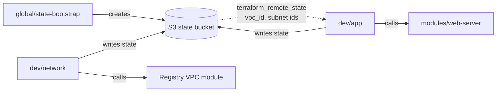

<div align="center">

# terraform-aws-mastery

Learning Terraform on AWS by building real things, one module at a time.


</div>

---

I started this repo to learn Terraform properly, not just copy snippets. Every folder here was planned, applied, checked in the browser and then destroyed. The layout follows what I see at work: environment first, then component, with shared modules on the side.

## Contents

- [What gets built](#what-gets-built)
- [Repo layout](#repo-layout)
- [How the pieces connect](#how-the-pieces-connect)
- [Getting started](#getting-started)
- [Daily use](#daily-use)
- [The web-server module](#the-web-server-module)
- [Notes and decisions](#notes-and-decisions)
- [Progress](#progress)

## What gets built

For each environment (`dev`, `stag`, `prod`):

| Component | What's inside | Comes from |
|---|---|---|
| `network` | VPC, 2 public subnets, internet gateway, route table | [terraform-aws-modules/vpc](https://registry.terraform.io/modules/terraform-aws-modules/vpc/aws) |
| `app` | Security group + EC2 running nginx | [`modules/web-server`](modules/web-server) |

Plus one shared S3 bucket in `global/` that stores the state of everything else.

| | dev | stag | prod |
|---|---|---|---|
| VPC CIDR | `10.0.0.0/16` | `10.2.0.0/16` | `10.1.0.0/16` |
| SSH | open to my IP only | off | off |
| Instance | `t3.micro` | `t3.micro` | `t3.micro` |

`stag` is a copy of `prod` with its own IP range. Changes go dev → stag → prod.

## Repo layout

```
.
├── modules/
│   └── web-server/          # reusable: security group + EC2 + nginx
├── global/
│   └── state-bootstrap/     # S3 bucket for remote state (keeps its own state locally)
├── dev/
│   ├── network/             # state key: dev/network/terraform.tfstate
│   └── app/                 # state key: dev/app/terraform.tfstate
├── stag/
│   ├── network/
│   └── app/
├── prod/
│   ├── network/
│   └── app/
├── backend.hcl.example      # copy to backend.hcl
└── CLAUDE.md                # my course plan and notes
```

Each folder is its own Terraform root with its own state. Breaking `app` can't touch `network`, and a plan in one folder only looks at that folder's resources.

## How the pieces connect



`app` never hardcodes a VPC ID. It reads the outputs of the `network` state, so `network` has to exist first.

## Getting started

<details>
<summary><b>What you need</b></summary>

<br>

- Terraform 1.5 or newer (I use 1.17)
- AWS CLI with a working profile: `aws sts get-caller-identity` should print your account
- An IAM user or role that can manage S3, VPC and EC2

</details>

<details>
<summary><b>1. Create the state bucket (one time only)</b></summary>

<br>

```bash
cd global/state-bootstrap
terraform init
terraform apply
terraform output -raw backend_hcl > ../../backend.hcl
```

The bucket name is `<project>-tfstate-<account_id>`, so it's unique per account. It has versioning, encryption and public access blocked.

This folder keeps its state on disk on purpose. It can't store its state in a bucket that doesn't exist yet.

</details>

<details>
<summary><b>2. Fill in the variables</b></summary>

<br>

```bash
cp dev/app/terraform.tfvars.example dev/app/terraform.tfvars
```

Same for `stag/app` and `prod/app` when you need them.

Then set `state_bucket`, and set `ssh_cidr` to your own IP (`curl ifconfig.me`) with `/32` at the end. Remove the `ssh_cidr` line to keep SSH closed.

</details>

## Daily use

<details open>
<summary><b>Bring up dev</b></summary>

<br>

```bash
cd dev/network
terraform init -backend-config=../../backend.hcl
terraform apply

cd ../app
terraform init -backend-config=../../backend.hcl
terraform apply
```

Open the `website_url` output. You should see:

```
Hello from a Terraform module!
Server: terraform-aws-mastery-dev-web
```

</details>

<details>
<summary><b>Tear it down</b></summary>

<br>

Always in reverse order. The server sits inside the VPC, so AWS won't delete the VPC while the server is still there.

```bash
cd dev/app     && terraform destroy
cd ../network  && terraform destroy
```

</details>

<details>
<summary><b>Switched the bucket or cloned on a new machine?</b></summary>

<br>

```bash
terraform init -backend-config=../../backend.hcl -reconfigure
```

`-reconfigure` forgets the old backend address. Use `-migrate-state` instead if you need to copy existing state over.

</details>

## The web-server module

```hcl
module "web" {
  source = "../../modules/web-server"

  name          = "terraform-aws-mastery-dev"
  vpc_id        = data.terraform_remote_state.network.outputs.vpc_id
  subnet_id     = data.terraform_remote_state.network.outputs.public_subnet_ids[0]
  instance_type = "t3.micro"
  ssh_cidr      = var.ssh_cidr   # null = no SSH rule at all
}
```

<details>
<summary><b>Inputs and outputs</b></summary>

<br>

| Input | Required | Default | Notes |
|---|---|---|---|
| `name` | yes | | prefix for every resource name |
| `vpc_id` | yes | | |
| `subnet_id` | yes | | must be a public subnet |
| `instance_type` | no | `t3.micro` | limited to small sizes to keep the bill low |
| `ssh_cidr` | no | `null` | your IP as `x.x.x.x/32` |

| Output | |
|---|---|
| `instance_id` | EC2 instance ID |
| `public_ip` | public IP of the server |
| `security_group_id` | ID of the security group |

The module has no `provider` block. Region and credentials come from whoever calls it.

</details>

## Notes and decisions

<details>
<summary><b>Why folders per environment and not workspaces?</b></summary>

<br>

With workspaces, the same folder serves dev and prod, and the only thing telling them apart is which workspace is selected. One forgotten `workspace select` and you're applying to prod. With folders, you have to `cd prod` first, and each environment can have its own backend or even its own AWS account later.

</details>

<details>
<summary><b>Why is backend.hcl not committed?</b></summary>

<br>

The repo is public and the bucket name contains my account ID. In a private company repo I'd commit it. Here there's `backend.hcl.example` instead.

</details>

<details>
<summary><b>What's ignored by Git</b></summary>

<br>

`*.tfstate*`, `.terraform/`, `backend.hcl` and `*.tfvars`. The `.terraform.lock.hcl` files **are** committed, so everyone gets the same provider versions.

</details>

<details>
<summary><b>Cost</b></summary>

<br>

Everything is small (`t3.micro`, no NAT gateway, no load balancer) and gets destroyed at the end of each session. The only thing left running is the state bucket, which costs next to nothing.

</details>

## Progress

- [x] Foundations: infrastructure as code, how Terraform compares code, state and real AWS
- [x] Setup: Terraform, AWS CLI, IAM user
- [x] Core workflow and HCL basics
- [x] Variables, outputs, locals and data sources
- [x] A real network: VPC, subnets, routing, security groups, nginx
- [x] State: S3 backend, locking, `state mv`, `import` and `removed` blocks, drift
- [x] Modules: local and Registry modules, remote state, env-first layout
- [ ] Pro practices: lifecycle rules, secrets, CI/CD with GitHub Actions
- [ ] Terraform Associate exam
