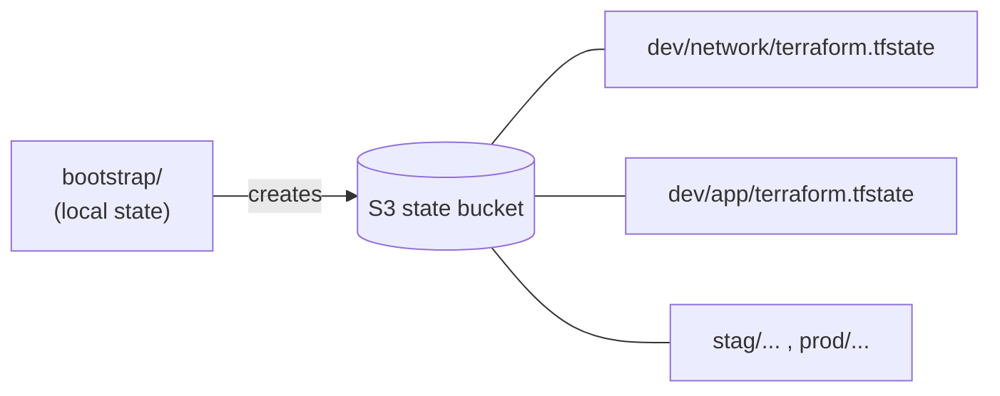

# bootstrap

Creates the S3 bucket that stores the Terraform state of every other folder in this repo.

> **Run this once per AWS account, before any other folder. Destroy it last.**

## Contents

- [Overview](#overview)
- [Requirements](#requirements)
- [What it creates](#what-it-creates)
- [Why its state stays local](#why-its-state-stays-local)
- [Usage](#usage)
- [Inputs](#inputs)
- [Outputs](#outputs)
- [Safety rules](#safety-rules)
- [If the local state is lost](#if-the-local-state-is-lost)
- [Cost](#cost)
- [Exam tips](#exam-tips)

## Overview

Every other folder keeps its state in this bucket, each under its own key.



This folder is kept apart from [`global/`](../global) because it has a different lifecycle: its state is local, it runs once, and everything else depends on it.

## Requirements

| Name | Version |
| --- | --- |
| Terraform | `>= 1.11.0` |
| AWS provider (`hashicorp/aws`) | `~> 6.0` |
| AWS CLI | configured with an IAM user that can manage S3 |

## What it creates

| Resource | Purpose |
| --- | --- |
| `aws_s3_bucket.state` | The bucket, named `<project>-tfstate-<account_id>`. The account ID makes the name unique, so no random suffix is needed. |
| `aws_s3_bucket_versioning.state` | Keeps every old version of each state file, so a broken state can be rolled back. |
| `aws_s3_bucket_server_side_encryption_configuration.state` | Encrypts files with AES256. State can hold secrets in plain text. |
| `aws_s3_bucket_public_access_block.state` | Makes sure the bucket can never become public. |

It also reads `aws_caller_identity` (a data source) to get the account ID.

## Why its state stays local

There is no `backend` block here. This folder creates the bucket, so its own state can't be stored in that bucket: the bucket doesn't exist yet when this folder runs.

The state stays in `terraform.tfstate` on disk. Git ignores that file, so **keep it safe**. Without it, Terraform no longer knows it manages the bucket. See [If the local state is lost](#if-the-local-state-is-lost).

## Usage

### 1. Check the AWS CLI

```bash
aws sts get-caller-identity
```

You should see your IAM user, not the root user.

### 2. Init

```bash
cd bootstrap
terraform init
```

### 3. Plan and apply

```bash
terraform plan     # Plan: 4 to add, 0 to change, 0 to destroy
terraform apply
```

### 4. Write the backend config for the other folders

```bash
terraform output -raw backend_hcl > ../backend.hcl
```

This creates `backend.hcl` in the repo root:

```hcl
bucket = "terraform-aws-mastery-tfstate-<account_id>"
region = "ap-south-1"
```

Every environment folder reads it with `terraform init -backend-config=../../backend.hcl`. Git ignores `backend.hcl` because the bucket name contains the account ID.

### 5. Destroy (only at the very end)

Destroy every environment folder first. Then remove the `prevent_destroy` block from `main.tf` and run:

```bash
terraform destroy
```

## Inputs

| Name | Description | Type | Default | Required |
| --- | --- | --- | --- | --- |
| `aws_region` | AWS region for the state bucket | `string` | `"ap-south-1"` | no |
| `project_name` | Used in the bucket name and tags | `string` | `"terraform-aws-mastery"` | no |

## Outputs

| Name | Description |
| --- | --- |
| `state_bucket` | Name of the state bucket |
| `backend_hcl` | Ready-to-use content for `../backend.hcl` |

## Safety rules

| Setting | What it does | When it takes effect |
| --- | --- | --- |
| `lifecycle { prevent_destroy = true }` | Any plan that would delete the bucket fails with an error. | On `destroy`, or on a change that forces a replace. |
| `force_destroy = true` | Lets Terraform delete the bucket even if it still has files. | Only on destroy. **Lab only.** In a real company, keep it `false`. |

> **Warning:** Changing `project_name` changes the bucket name. S3 buckets can't be renamed, so Terraform would destroy the bucket and create a new one, along with every state file inside it. `prevent_destroy` blocks this plan.

## If the local state is lost

If the bucket still exists in AWS but `terraform.tfstate` is gone, don't run `apply`. It would try to create a bucket that already exists. Bring the bucket back under Terraform with `import` blocks instead.

Create `imports.tf`:

```hcl
# Learning repo: this file is kept to show how the import was done.
# In a real project, delete it after the import is applied.

import {
  to = aws_s3_bucket.state
  id = "terraform-aws-mastery-tfstate-<account_id>"
}

import {
  to = aws_s3_bucket_versioning.state
  id = "terraform-aws-mastery-tfstate-<account_id>"
}

import {
  to = aws_s3_bucket_server_side_encryption_configuration.state
  id = "terraform-aws-mastery-tfstate-<account_id>"
}

import {
  to = aws_s3_bucket_public_access_block.state
  id = "terraform-aws-mastery-tfstate-<account_id>"
}
```

Then run `terraform plan`. It should say `4 to import` and nothing to add or destroy. If it does, run `terraform apply`.

## Cost

Almost free. State files are a few KB each. S3 charges per GB stored and per request, so this costs well under $0.01 a month.

## Exam tips

- The bucket that stores state can't store its own state. The usual answer is a separate folder with local state.
- A `backend` block can't use variables. Use partial config with `-backend-config`, as this repo does.
- S3 native locking (`use_lockfile = true`) needs Terraform 1.11 or newer. DynamoDB locking is deprecated.
- Turn on versioning for the state bucket, so you can roll back a broken state.
- `prevent_destroy` only protects against Terraform. If you remove the block from the code, the protection is gone too.
